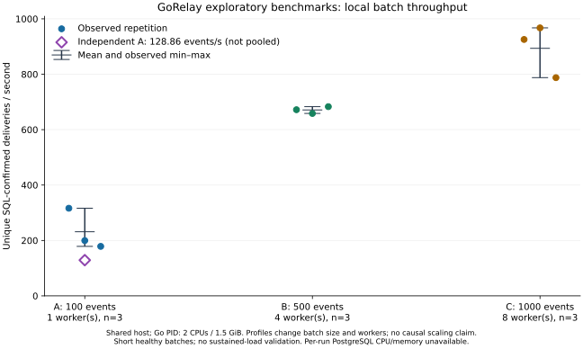
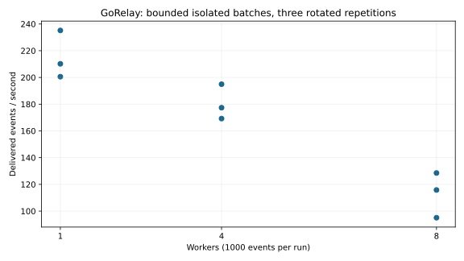

# Exploratory and controlled batch evidence

These are historical local experiments, not new measurements on the published
revision. Dependency changes and a different host may change the results. The
curated CSVs preserve source numeric strings; only local fixture identifiers were
removed and line endings normalized. provenance.json records source/data hashes.

## Exploratory batches (Stage5A)

Nine short batches delivered4, 800synthetic1KiB events. Profiles changed both event
count and worker count:100/1worker, 500/4workers, 1, 000/8workers, three repeats each.
Their mean delivery rates were231.48, 671.09 and893.49events/s respectively.
An independent 100-event/1-worker repeat measured 128.86 events/s and was not pooled
into those means. Varying batch sizes means this is not a worker-scaling experiment.

[CSV](exploratory-summary.csv). The independent repeat is shown separately in the
historical plot; its lower result is retained rather than hidden.

## Fixed-size batches (Stage5B)

1, 000events per run, 1/4/8 workers, three repetitions each in rotated order. All9, 000
deliveries and9, 000HTTP attempts reconciled to SQL in the historical healthy-target
experiment. The public per-run CSV retains attempts, latencies, CPU time, memory and
pool samples; the original local SQL schema names are excluded.

| Workers | Mean deliveries/s | Min–max | Sample CV |
| --- | --- | --- | --- |
| 1 | 215.31 | 200.56–235.17 | 8.30% |
| 4 | 180.51 | 169.22–194.95 | 7.29% |
| 8 | 113.12 | 95.05–128.51 | 14.93% |

**Throughput decreased as worker count increased** under these controls. No
single cause was demonstrated. Database contention, CPU scheduling, HTTP overhead
and shared-host behavior are hypotheses, not measured causal conclusions.

[CSV](controlled-runs.csv). Go was limited to 2 CPUs /1536 MiB; PostgreSQL 1 CPU /512 MiB.
Setup/migrations were excluded from measured windows. Resource samples are not
complete process/server profiling. The stability result was a 300-event /30-second
pilot, not a completed two-minute or sustained-production test. An initial failed
resource-limited execution (exit 137) was excluded from valid experiments and
retained privately with the original evidence; it was not counted as a valid run.

No guaranteed throughput, production capacity, linear scalability or hardware-neutral
SLA follows from these short batches. Assets retain independent reuse rights
under the repository's ASSET-RIGHTS.md notice.
